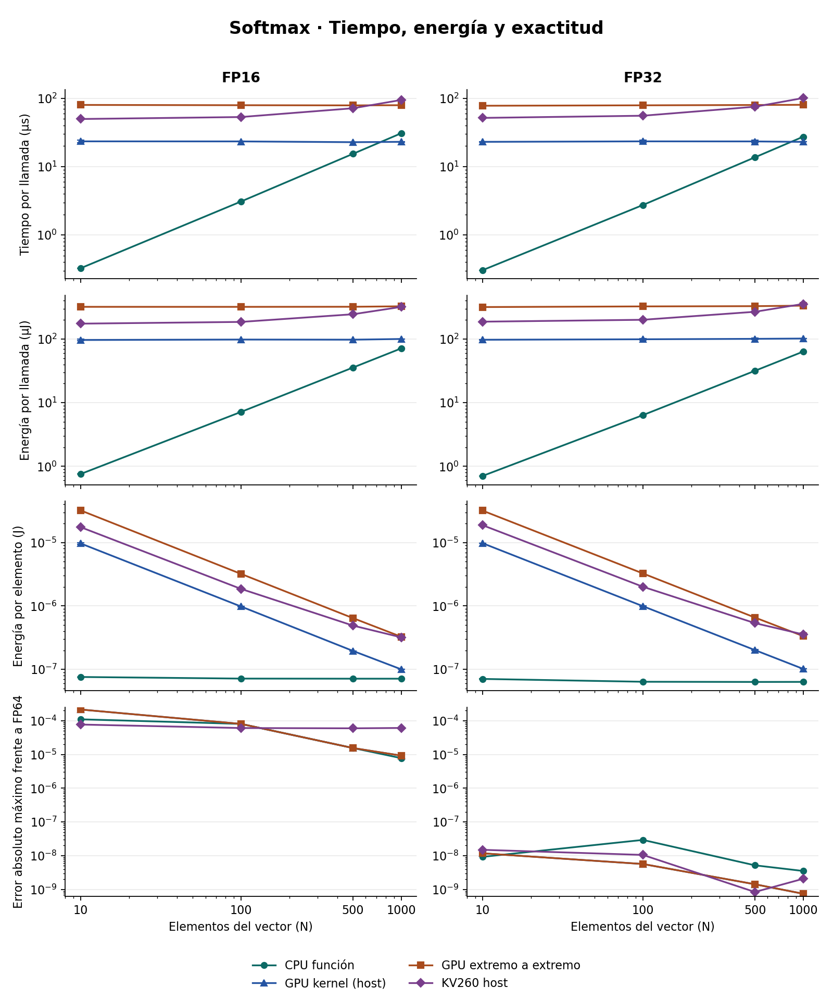

# Ejercicio D — Medición de energía

Se mide Softmax en FP16 y FP32 para N = 10, 100, 500 y 1000. La energía corresponde al riel de entrada del módulo e incluye el consumo del procesador que ejecuta el host.

## Método

| Plataforma | Instrumento y punto de medición | Condiciones |
|---|---|---|
| Jetson Nano, CPU y GPU | INA3221 mediante `tegrastats` en el riel de 5 V `POM_5V_IN`. | Modo `MAXN` (0), lecturas cada 100 ms y cinco lotes de alrededor de 3 s por caso. El ensayo de GPU se hizo con `jetson_clocks`. |
| Kria KV260, FP16 | INA260 del SOM mediante `hwmon/power1_input`. | Reloj del kernel de 199,998 MHz. Se midieron cinco lotes por tamaño para V3 y tres para cada una de las variantes V0 a V2. Cada lote tuvo 20 000 llamadas medidas y 1000 llamadas de calentamiento excluidas. El host registró unas 770 lecturas por segundo. |
| Kria KV260, FP32 | INA260 del SOM mediante `hwmon/power1_input`. | Variante V0. Un lote de 5000 llamadas medidas por tamaño, con tres llamadas de calentamiento excluidas. |

El INA260 de la KV260 mide el riel de 5 V del SOM. La tasa de 770 lecturas/s corresponde al sondeo del host. La temperatura de los lotes y el intervalo interno de actualización del sensor quedaron sin verificar. [Hoja de datos de la KV260](https://docs.amd.com/r/en-US/ds986-kv260-starter-kit/Power-and-Electrical)

La energía del lote se estima como la potencia promedio multiplicada por su duración. La energía por llamada se obtiene al dividir entre las repeticiones medidas. Para obtener J/elemento se convierte a joules y se divide entre N. El cálculo usa la potencia total del módulo e incluye el consumo en reposo.

En CPU se muestra el tiempo de la función. En GPU, el modo `kernel` se midió en el host y la columna `nvprof` corresponde al kernel en el dispositivo. El modo de extremo a extremo incluye transferencias. En la KV260 se usa el tiempo total del host, con una H2D y una D2H amortizadas por lote.

En la tabla de KV260 se presenta la variante final V3 para FP16 y la variante V0 para FP32. Las filas de V3 muestran la **mediana [mínimo, máximo]** de los cinco lotes para el tiempo, la potencia y la energía. Las demás filas muestran la media y, cuando hay más de un lote, la desviación estándar muestral para el tiempo y la energía por llamada. La última columna indica el error absoluto máximo frente a FP64.

## Resultados FP16

| Plataforma | N | Tiempo (µs/llamada) | Kernel nvprof (µs) | Potencia (W) | Energía (µJ/llamada) | J/elemento | Error máx. frente a FP64 |
|---|---:|---:|---:|---:|---:|---:|---:|
| CPU función | 10 | 0.3273 ± 2.578e-05 | — | 2.319 | 0.7589 ± 0.0003124 | 7.589e-08 | 0.0001103 |
| GPU kernel (host) | 10 | 23.41 ± 1.09 | 3.629 | 4.132 | 96.64 ± 2.376 | 9.664e-06 | 0.000215 |
| GPU extremo a extremo | 10 | 79.77 ± 3.333 | — | 4.023 | 320.8 ± 8.831 | 3.208e-05 | 0.000215 |
| KV260 host V3 | 10 | 49.775 [49.366, 49.964] | — | 3.512 [3.510, 3.520] | 174.795 [173.691, 175.849] | 1.74795e-05 [1.73691e-05, 1.75849e-05] | 7.717e-05 |
| CPU función | 100 | 3.087 ± 0.0009888 | — | 2.319 | 7.159 ± 0.005524 | 7.159e-08 | 8.065e-05 |
| GPU kernel (host) | 100 | 23.36 ± 0.1329 | 3.516 | 4.201 | 98.13 ± 0.8706 | 9.813e-07 | 8.065e-05 |
| GPU extremo a extremo | 100 | 79.02 ± 3.196 | — | 4.057 | 320.5 ± 8.857 | 3.205e-06 | 8.065e-05 |
| KV260 host V3 | 100 | 53.092 [52.637, 53.496] | — | 3.504 [3.493, 3.506] | 186.128 [184.075, 187.121] | 1.86128e-06 [1.84075e-06, 1.87121e-06] | 6.078e-05 |
| CPU función | 500 | 15.38 ± 0.004053 | — | 2.319 | 35.66 ± 0.02662 | 7.132e-08 | 1.553e-05 |
| GPU kernel (host) | 500 | 22.77 ± 0.04352 | 4.35 | 4.292 | 97.72 ± 0.2899 | 1.954e-07 | 1.553e-05 |
| GPU extremo a extremo | 500 | 78.56 ± 0.2753 | — | 4.094 | 321.6 ± 0.913 | 6.432e-07 | 1.553e-05 |
| KV260 host V3 | 500 | 70.912 [70.882, 72.093] | — | 3.441 [3.433, 3.443] | 244.046 [244.014, 247.815] | 4.88091e-07 [4.88028e-07, 4.95630e-07] | 5.965e-05 |
| CPU función | 1000 | 30.73 ± 0.0004438 | — | 2.32 | 71.3 ± 0.05732 | 7.13e-08 | 7.789e-06 |
| GPU kernel (host) | 1000 | 23.03 ± 0.1103 | 5.844 | 4.352 | 100.2 ± 0.3264 | 1.002e-07 | 9.243e-06 |
| GPU extremo a extremo | 1000 | 79.05 ± 0.1797 | — | 4.136 | 327 ± 1.744 | 3.27e-07 | 9.243e-06 |
| KV260 host V3 | 1000 | 93.789 [93.686, 95.535] | — | 3.393 [3.382, 3.413] | 318.303 [317.264, 326.070] | 3.18303e-07 [3.17264e-07, 3.26070e-07] | 6.108e-05 |

## Resultados FP32

| Plataforma | N | Tiempo (µs/llamada) | Kernel nvprof (µs) | Potencia (W) | Energía (µJ/llamada) | J/elemento | Error máx. frente a FP64 |
|---|---:|---:|---:|---:|---:|---:|---:|
| CPU función | 10 | 0.3063 ± 0.0001257 | — | 2.309 | 0.7072 ± 0.003469 | 7.072e-08 | 9.212e-09 |
| GPU kernel (host) | 10 | 23.02 ± 0.1096 | 3.512 | 4.232 | 97.44 ± 0.4094 | 9.744e-06 | 1.171e-08 |
| GPU extremo a extremo | 10 | 77.64 ± 0.5869 | — | 4.098 | 318.2 ± 1.628 | 3.182e-05 | 1.171e-08 |
| KV260 host V0 | 10 | 51.55 | — | 3.637 | 187.5 | 1.875e-05 | 1.49e-08 |
| CPU función | 100 | 2.745 ± 0.000317 | — | 2.324 | 6.379 ± 0.02965 | 6.379e-08 | 2.927e-08 |
| GPU kernel (host) | 100 | 23.4 ± 0.9524 | 3.395 | 4.24 | 99.19 ± 2.289 | 9.919e-07 | 5.653e-09 |
| GPU extremo a extremo | 100 | 78.73 ± 0.9538 | — | 4.136 | 325.7 ± 5.658 | 3.257e-06 | 5.653e-09 |
| KV260 host V0 | 100 | 55.46 | — | 3.620 | 200.8 | 2.008e-06 | 1.051e-08 |
| CPU función | 500 | 13.67 ± 5.723e-05 | — | 2.319 | 31.69 ± 0.04207 | 6.338e-08 | 5.17e-09 |
| GPU kernel (host) | 500 | 23.35 ± 1.064 | 4.288 | 4.318 | 100.8 ± 2.476 | 2.015e-07 | 1.418e-09 |
| GPU extremo a extremo | 500 | 79.58 ± 0.06073 | — | 4.13 | 328.7 ± 0.4897 | 6.573e-07 | 1.418e-09 |
| KV260 host V0 | 500 | 75.07 | — | 3.572 | 268.2 | 5.363e-07 | 8.361e-10 |
| CPU función | 1000 | 27.35 ± 0.0005836 | — | 2.321 | 63.49 ± 0.06324 | 6.349e-08 | 3.513e-09 |
| GPU kernel (host) | 1000 | 23 ± 0.02634 | 5.845 | 4.428 | 101.8 ± 0.1679 | 1.018e-07 | 7.422e-10 |
| GPU extremo a extremo | 1000 | 80.1 ± 0.2108 | — | 4.179 | 334.8 ± 2.281 | 3.348e-07 | 7.422e-10 |
| KV260 host V0 | 1000 | 100.6 | — | 3.542 | 356.1 | 3.561e-07 | 2.062e-09 |


## Preguntas del enunciado

### 1. ¿Qué etapa domina el tiempo en cada plataforma y cómo cambia con N?

En la CPU domina el cálculo de las exponenciales (`expf`). A partir de N=100, el tiempo crece aproximadamente en proporción al número de elementos. En la GPU, el kernel tarda entre 3,4 y 5,8 µs, mientras que la ejecución de extremo a extremo ronda los 78–80 µs. En ese recorrido pesan sobre todo las transferencias, el lanzamiento y la sincronización. En la KV260, el costo del host y de XRT pesa más para vectores pequeños. En FP16 V0, la latencia estimada del IP pasa de 5,604 a 193,903 µs al subir de N=10 a N=1000 y representa una fracción cada vez mayor del tiempo total.

### 2. ¿Qué diferencia de error aparece entre FP16 y FP32? ¿Se debe al formato, la exponencial o la reducción?

El mayor error absoluto observado fue de alrededor de 2,15 × 10⁻⁴ en FP16 y 2,93 × 10⁻⁸ en FP32. En la KV260, FP16 redondea las entradas, los resultados de las exponenciales, el denominador y la salida. La suma se acumula en `float` y después se convierte a FP16 para normalizar. Las mediciones reflejan el efecto combinado de esos redondeos. Para atribuir cuánto aporta cada etapa habría que variar su precisión por separado. CPU y GPU usaron MT19937, mientras que la KV260 usó un generador congruencial lineal. Cada plataforma calculó su referencia FP64 sobre su propio vector.

### 3. ¿Por qué la GPU puede ser peor que la CPU para vectores pequeños?

Para N=10 en FP16, la CPU tardó 0,327 µs por llamada. El kernel de GPU tardó 3,629 µs y la ejecución de extremo a extremo llegó a 79,77 µs. Con tan pocos elementos, el trabajo por llamada es pequeño y el costo fijo de transferir los datos, lanzar el kernel y esperar su resultado pesa más que el cómputo.

### 4. ¿Qué diferencia hay entre la latencia HLS y el tiempo total observado desde el host?

La cosimulación C/RTL mide en ciclos la duración de una transacción dentro del acelerador. El tiempo total observado desde el host incluye el lanzamiento y la espera de XRT, además de las transferencias amortizadas por lote. Para FP16 V0 con N=1000, la cosimulación registró 38 271 ciclos. En la placa, la traza del IP dio una mediana estimada de 193,903 µs y el tiempo total observado desde el host fue de 243,488 µs por llamada. [Resultados de la KV260](<../Ejercicio C: HLS para KV260/README.md>).

### 5. ¿Qué optimización HLS mejoró más la latencia y cuánto aumentó el uso de recursos?

La mejora más grande entre variantes consecutivas se obtuvo al pasar de V0 a V1 con `PIPELINE`. En FP16, para N=1000, la mediana estimada de la latencia del IP bajó de 193,903 a 49,265 µs, una reducción del 74,6 %. La síntesis reportó 332 LUT y 89 FF adicionales. El uso de BRAM se mantuvo en cuatro bloques y los DSP bajaron de seis a cuatro. En FP32, la cosimulación para N=1000 pasó de 13 461 a 9465 ciclos, una reducción del 29,7 %, con 330 LUT y 215 FF adicionales. El uso de BRAM y DSP se mantuvo en seis y nueve, respectivamente. [Recursos y latencias HLS](<../Ejercicio C: HLS para KV260/README.md>).

### 6. ¿Cuál plataforma minimiza el tiempo y cuál la energía por elemento? ¿Cambia entre FP16 y FP32?

La CPU tuvo la menor energía por elemento en los cuatro tamaños y en ambas precisiones. También registró el menor tiempo al comparar la función en CPU con la GPU de extremo a extremo y el tiempo total desde el host de la KV260. Si se compara el kernel de GPU medido con `nvprof` contra la función en CPU, la GPU fue más rápida para N=500 y N=1000 en ambas precisiones. Por ejemplo, para N=1000 en FP32, el kernel de GPU tardó 5,845 µs, la función en CPU 27,35 µs y la GPU de extremo a extremo 80,1 µs.


## Gráficas y archivos

Las gráficas muestran la media y las barras representan una desviación estándar muestral entre lotes o mediciones disponibles. Las gráficas de FP16 V3 usan cinco lotes por tamaño. Para KV260 FP32 hay un lote por tamaño, por lo que la dispersión queda sin dato. El panel de error grafica la media del error absoluto máximo de cada medición frente a FP64.



- [48 lotes iniciales de KV260 FP16](resultados/energia_kv260_fp16.csv) y [registro del sensor](resultados/sensor_kv260_fp16.txt).
- [Lotes 4 y 5 de V3 para los cuatro tamaños](resultados/complemento_V3.BNoUbZ/).
- [CSV de comparación consolidada](resultados/comparacion.csv).
- Mediciones de origen en [CPU](<../Ejercicio A: CPU de la Jetson Nano/resultados/cpu_energia_detalle.csv>), [GPU](<../Ejercicio B: GPU CUDA en la Jetson Nano/resultados/gpu_energia_detalle.csv>) y [KV260 FP32](<../Ejercicio C: HLS para KV260/SW/>).
- [Síntesis y latencias de la KV260](<../Ejercicio C: HLS para KV260/README.md>).

Para regenerar el CSV y las gráficas con Python y Matplotlib, ejecutá desde la raíz del repositorio:

```bash
python3 'Ejercicio D: Medicion de energia/analizar.py'
```